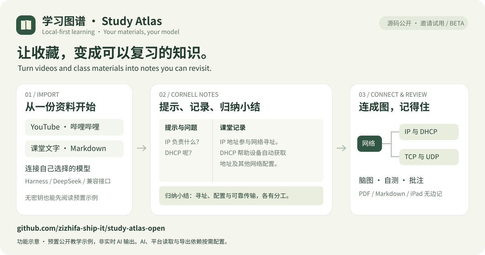

# Study Atlas

[简体中文](README.md)

[下载测试版 / Download beta](https://github.com/zizhifa-ship-it/study-atlas-open/releases/tag/v0.1.0-beta.1) · [无密钥试用 / Try the sample](docs/试用与反馈.md) · [试用反馈 / Feedback](https://github.com/zizhifa-ship-it/study-atlas-open/issues/new?template=03-trial-feedback.yml) · [报告问题 / Report a bug](https://github.com/zizhifa-ship-it/study-atlas-open/issues/new?template=01-bug-report.yml)




> **Noncommercial use is free. Commercial use of newly licensed material requires prior written permission from [zizhifa-ship-it](https://github.com/zizhifa-ship-it) and individually agreed fees.** [Policy and application](COMMERCIAL-LICENSE.md) · [Apply](https://github.com/zizhifa-ship-it/study-atlas-open/issues/new?template=commercial-license.yml). Previously MIT-licensed material retains its existing rights.

## Overview / 简介

A local-first AI learning library designed for beginners to explore and customize. Organize **categories → videos or class materials → notes**: paste public YouTube / Bilibili links or import text, Markdown and captions, connect your preferred model, and create source-backed knowledge modules, Cornell notes, mind maps, translations and review questions. Export PDF / iPad Freeform materials and JSON backups. The interface is currently primarily Simplified Chinese.

一个在自己电脑运行的 AI 学习知识库，适合初学者阅读和修改。按 **分类 → 视频或课堂资料 → 笔记** 整理内容，连接自己选择的模型，生成知识模块、康奈尔笔记、脑图、翻译和复习题，支持 PDF / iPad 无边记导出与 JSON 备份。详细中文说明见 [中文指南](README.md)。

> **许可：**非商业免费；受新许可约束的内容，商业使用须先获得书面许可并按约付费。旧 MIT 内容保留原权利，详见 [许可政策与申请](COMMERCIAL-LICENSE.md)。

## Run locally

Download the source ZIP and extract it into your own user folder. Python **3.9+** is required. Core storage, annotations, text imports and JSON / Markdown backups use only Python's standard library.

- Windows: double-click `start.bat`, or run `py -3 server.py --open`.
- macOS / Linux: run `sh start.sh` in the project folder.
- All platforms: `python server.py --open` with the appropriate Python executable.

Open `http://127.0.0.1:8765`. Keep the terminal running. Use `--port 8766` if needed. By default the app binds to loopback only. To use an iPad/phone on the same trusted Wi-Fi, start with `sh start.sh --lan` (or `start.bat --lan`), then open the private IP printed in the terminal and enter the code from `.local/lan-code.txt`. LAN mode is opt-in and requires a session cookie; it is not public hosting. See [LAN and iPad access](docs/局域网与iPad访问.md).

Open **首次使用 / 环境自检** in the sidebar for a read-only setup check. You can import TXT, Markdown, PDF, DOCX, HTML or caption files before connecting AI. Text is extracted locally without a model call; plain text and Markdown preserve code indentation and line breaks. You can also use a local file as an AI study aid for an existing long video: the app extracts a bounded local outline and sends only that outline to the model, keeping the full file and original transcript out of the prompt. You can also append, replace, save only, rebuild modules, or run a full refresh.

## Choose an AI connection

Use an existing DeepSeek Harness, the official DeepSeek API, or the compatible-interface option with **Ollama, LM Studio, SiliconFlow or OpenRouter**. Local model servers require no Harness account. Select a provider, read its model list or enter a model ID, then save. Model quality and hardware requirements vary.

Local endpoints are restricted to loopback; cloud endpoints use fixed official addresses. Credentials are isolated per provider and redirects are rejected. Requests use non-streaming Chat Completions. See the [installation and provider guide](docs/安装与兼容接口.md) for supported endpoints and limitations.

## Optional features

PDF / Apple Freeform exports need `requirements.txt` and a Chinese font. Video extraction needs yt-dlp and may need Node.js. Local multilingual transcription needs Python 3.10+ and `tools/setup_transcription.py`; installation downloads model weights. These dependencies are optional for text-only use.

For one course at a time, the **full video handout** adds a cover, chapter index, clickable timecodes and the complete saved transcript to the PDF and per-page PNGs. Its ZIP also includes a Markdown handout for Freeform, GoodNotes, Obsidian or Notion. The default AI-note export still excludes the raw transcript.

The **paper knowledge base** resolves public DOI / arXiv metadata into a local reading list, tracks screening and reading stages, stores structured appraisal and page-level evidence, builds a review matrix from included papers, and exports BibTeX, RIS, Markdown and CSV. Metadata lookup happens only when requested and sends no notes or credentials.

## Privacy and portability

Personal data stays in `data/library.json`; credentials, caches and models stay in `.local/` or ignored virtual environments. They are excluded from the public source package. Selected learning content is sent to the AI provider you configure; local storage does not mean cloud inference never receives it.

Export a complete JSON backup before upgrading or changing computers. Import it into a fresh installation; duplicate sources retain the existing version. Credentials and cached video frames are not included. Reconfigure connections on the new machine.

This is a single-user app. LAN mode shares the same local library with trusted devices after login, but it is not multi-user hosting or online sync. LAN HTTP is not encrypted; use a trusted network or a private Tailscale network. Public hosting requires a separate design for authentication, HTTPS, permissions and data isolation.

## Development

```sh
python -m unittest discover -s tests -v
npm run check
npm run test:js
```

Browser tests use isolated temporary data and simulated AI. They require Playwright and a browser. The CI workflow defines Windows / macOS / Linux startup and onboarding tests on Python 3.9 and 3.12; check Actions for actual run results.

## License and commercial use

New original material, to the extent the maintainer has authority to license it, is covered by [LICENSE](LICENSE): noncommercial use is free, and commercial use requires a separate written license and compliance with agreed payment conditions. Prices and scope are quoted individually through the [commercial application](COMMERCIAL-LICENSE.md). A request, donation or payment alone does not grant a license.

Code and documentation previously published under MIT through commit `7bcb7e431bc6a7f1725cbab534906afbb7f7285e`, including the existing core functionality and that material retained in later releases, remain under [the original MIT license](LICENSE-MIT-LEGACY), including commercial-use rights. This change is not retroactive. The new restricted license is source-available, not OSI open source. Third-party rights remain unchanged.

Reproducible bug reports are welcome. Do not attach credentials, personal libraries or private captions to public issues.

### Long videos and PDF import

Transcripts and text materials support up to 3,000,000 characters without silently dropping the tail. Long sources use bounded paragraph chunks, hierarchical summaries and validated, model-specific caches; completed chunks can be reused after interruption. Local models receive smaller inputs. AI digests can still miss details; check the source.

Import a PDF from onboarding/material import, preview extracted text and page numbers, then save and optionally generate Cornell notes, knowledge modules and mind maps. PDFs can also supplement an existing video under Quality & Sources. Install `python3 -m pip install -r requirements.txt`. Limits: 32 MB, 1,000 pages, 3,000,000 characters. Unlock password-protected PDFs first; scanned pages require external OCR. Images are not interpreted, and pages with no readable text produce a warning. Parsing runs in a local, time-limited worker; original PDF bytes are not retained. Only extracted text is saved and, when requested, sent to your selected AI provider.

### Independent iPad access and web API mode

Select **DeepSeek official API** in AI settings to check connectivity, load your account's model list and save the selected model from the website. Keys stay in the backend. For use while your Mac is off, deploy the optional single-owner HTTPS server using `deploy/compose.yml`; it reuses the current library, task queue and note pipeline, while local Harness support stays available in the desktop installation. See [deployment and web API instructions](docs/iPad独立部署与网页API.md). Configuration is supplied; no hosted instance is created automatically.

### Browser-only edition: no running Mac required

Open [Study Atlas Browser](https://zizhifa-ship-it.github.io/study-atlas-open/) on iPad Safari. Bring your own DeepSeek API key, choose an account model, import PDF/text/transcripts, and create Cornell notes, knowledge modules, mind maps and source-based chat. The static client calls DeepSeek directly; no Python, Harness or personal server is required.

Notes stay in the current browser's IndexedDB; the key is kept in page memory by default and is cleared on reload. Export JSON before clearing browser data. There is no automatic cross-device sync. Video links can be saved, but platform captions may be blocked by browser CORS; supply transcripts or handouts rather than generating content from titles. Desktop and private-server editions remain available. See the [browser guide](docs/浏览器独立版.md).

### Concise reading and saved-task recovery

The browser edition reopens saved notes after reload and merges repeated source imports. Generation and auditing are saved separately; reconnecting continues the unfinished stage. Uncertain network outcomes pause before another paid request. Keys remain in page memory, while notes remain in the current browser.

Memory cards show the core relationship, one example, a caution and questions with hidden answers. Full Cornell notes, formulas and procedures remain available under the full-notes tab. Self-assessment saves local review progress without calling a model. New notes avoid padding and repetition; existing notes are preserved unless the user explicitly confirms a rewrite.
