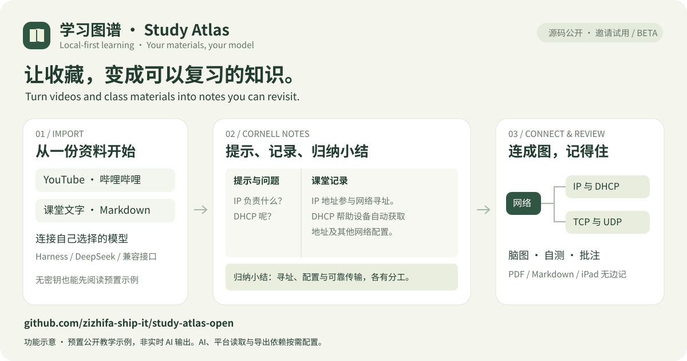

# 学习图谱 · Study Atlas

[English](README.en.md)

[下载测试版 / Download beta](https://github.com/zizhifa-ship-it/study-atlas-open/releases/tag/v0.1.0-beta.1) · [无密钥试用 / Try the sample](docs/试用与反馈.md) · [试用反馈 / Feedback](https://github.com/zizhifa-ship-it/study-atlas-open/issues/new?template=03-trial-feedback.yml) · [报告问题 / Report a bug](https://github.com/zizhifa-ship-it/study-atlas-open/issues/new?template=01-bug-report.yml)




> **许可政策：非商业用途免费；受新许可约束的新增内容，商业用途须向 [zizhifa-ship-it](https://github.com/zizhifa-ship-it) 申请、获得书面许可并按约付费。** [申请与收费说明](COMMERCIAL-LICENSE.md) · [提交申请](https://github.com/zizhifa-ship-it/study-atlas-open/issues/new?template=commercial-license.yml)。已按 MIT 发布的旧版及其代码保留原权利，详见下方许可说明。

## 简介 / Overview

一个在自己电脑运行的 AI 学习知识库，适合初学者阅读和修改。按 **分类 → 视频或课堂资料 → 笔记** 整理内容：粘贴 YouTube / 哔哩哔哩链接，或导入文字、Markdown、字幕，连接自己选择的模型，生成知识模块、康奈尔笔记、脑图、翻译和复习题；支持 PDF / iPad 无边记导出、JSON 备份，以及 DOI / arXiv 论文知识库与学术路径。界面目前主要使用简体中文。

A local-first AI learning library designed for beginners to explore and customize. Organize **categories → videos or class materials → notes**: paste YouTube / Bilibili links or import text, Markdown and captions, connect your preferred model, and create knowledge modules, Cornell notes, mind maps, translations and review questions. Export PDF / iPad Freeform materials and JSON backups, and manage a DOI / arXiv paper library with an academic review path. The interface is currently primarily Simplified Chinese. See the [English guide](README.en.md) for installation and details.

> **License:** Noncommercial use is free. Commercial use of newly licensed material requires prior written permission and agreed fees; previously MIT-licensed material retains its original rights. [Licensing policy and application](COMMERCIAL-LICENSE.md).

## 主要功能 / Key features

- 粘贴公开 YouTube、哔哩哔哩或 b23.tv 链接，自动识别标题和作者、读取原语言字幕或本机语音转录、AI 分类并写笔记，保存到本机。
- 优先归入现有分类，没有合适分类时由 AI 建立新分类；支持手动调整多级目录。
- 收藏 YouTube、哔哩哔哩和其他平台的视频链接。也可直接导入课堂 TXT / Markdown 或字幕，不需要虚构视频链接。
- 标记待学习、学习中、已学完，以及重点收藏。
- AI 构建详尽知识模块：学习目标、前置知识、概念、解释、例子、易错点与复习问答。
- 交互脑图支持展开、收起、点击跳到模块以及 SVG 下载。
- 后台第二轮 AI 自查；结果、来源和修订记录放在单独的“质量与来源”板块。
- 模块问答自动成为自测题；独立作答后，由当前 AI 对照已保存资料批改并保存反馈。
- 错题本、按课程筛选、作答历史和简单间隔复习；看过参考答案的练习单独标记。
- 为视频写知识总结和带时间点的个人补充。
- 搜索标题、作者、分类、标签及笔记正文。
- 导出完整 JSON 备份或 Markdown 笔记，合并导入备份。
- 单门课程可导出“完整视频讲义”：封面、AI 笔记、章节目录、可点击时间码和完整字幕；PDF/逐页 PNG 可导入无边记，素材包内的 Markdown 可导入 Obsidian、Notion 等笔记软件。
- 论文知识库：按 DOI / arXiv 读取公开题录，记录筛选、精读、页码摘录与研究问题；把已纳入论文组成综述矩阵，导出 BibTeX、RIS 和 CSV。
- 每次保存前自动备份，保留最近 30 份；不同页面的保存冲突会提示。
- 整理任务页显示真实步骤、排队位置及已保存模块；中断后按原任务范围继续，避免重做已完成的导入与总结。
- 连接本机 DeepSeek Harness，从实际目录自选模型与推理强度；也可独立使用 DeepSeek 官方 API、Ollama、LM Studio、硅基流动或 OpenRouter。
- 在“AI 连接设置”中刷新模型列表、选择后保存；新笔记、脑图、译文和自查使用该模型。生成途中禁止切换，检查连接不会覆盖选择，模型失效会提示而不自动换用其他模型。
- Harness 的模型选择接口也会保存其自身默认值；供应商与模型需先在 Harness 配置好。模型、供应商和推理强度分别隔离响应缓存与模块续作检查点。
- AI 设置只显示当前接入方式需要的选项，用量及本机保护说明默认折叠。任务恢复规则见 [整理任务与中断恢复](docs/整理任务与中断恢复.md)。
- 根据字幕、转录和现有笔记自动写好总结并保存，保留旧版与人工补充。
- 比较多条视频的共通规律、差异和适用条件，归纳可复用经验并保留来源。
- 可选：通过 YouTube 官方只读授权读取自己的频道和播放列表；粘贴链接不需要账号授权。

默认提供通用学习分类和空白视频库。首次启动时自动从 `data/library.example.json` 创建本机数据文件。许可及商业申请见 [LICENSE](LICENSE) 与 [商业许可说明](COMMERCIAL-LICENSE.md)，个人学习资料与连接凭据不提交。

## Windows、macOS、Linux 启动

先安装 Python 3.9+，下载公开源码 ZIP 并解压到自己的用户目录。核心功能只用标准库，无需 npm 包或数据库。

- **Windows**：双击 `start.bat`，或在项目目录执行 `py -3 server.py --open`。
- **macOS / Linux**：在项目目录执行 `sh start.sh`。
- 也可直接执行 `python3 server.py --open`（Windows 可用 `python` 或 `py -3`）。

打开 <http://127.0.0.1:8765>，保持终端运行。启动器优先使用项目 `.venv`。端口冲突时加 `--port 8766`。macOS 使用 `.command` 前需先赋予执行权限，也可以直接使用上面的终端命令。

**同一 Wi-Fi 的 iPad / 手机**：运行 `sh start.sh --lan`（Windows 用 `start.bat --lan`）。终端会打印私网 IP 和固定的 Bonjour 地址（如 `http://<电脑名>.local:8765/`），登录码在 `.local/lan-code.txt`；在 iPad 打开地址并输入登录码即可。Wi‑Fi 重新分配 IP 后，`.local` 地址通常仍可用。该模式只接受私网 / `.local` 地址，登录后使用 HttpOnly、SameSite 会话；默认本机模式不开启。不要做公网端口转发。详见 [局域网与 iPad 访问](docs/局域网与iPad访问.md)。

先打开左侧 **首次使用 / 环境自检**。没有 AI 密钥也能保存课堂资料、分类、批注和备份；视频提取、AI、转录及 PDF 是按需启用的能力。安装、可选依赖、模型接入、备份迁移及验证边界见 [安装与兼容接口指南](docs/安装与兼容接口.md)。

## 第一次使用

1. 在“首次使用 / 环境自检”选择文字资料入库，或在“AI / Harness 设置”选择自己可用的模型服务。
2. 安装 [yt-dlp](https://github.com/yt-dlp/yt-dlp#installation) 及其 YouTube 提取所需的 JavaScript 运行时（本项目会检测 Node.js）。
3. 点“粘贴链接一键整理”，填写公开 YouTube 或哔哩哔哩视频链接。无需 Google Cloud 或 YouTube 账号授权。
4. 网站在后台识别标题、读取公开字幕、自动分类、生成中文笔记并保存。页面会显示进度；保持启动窗口运行，可以离开当前页面。
5. 打开知识总结核对内容；用顶部搜索查找知识点。按 `/` 定位搜索框。

目前一键整理支持公开 YouTube 和哔哩哔哩视频。B站分 P 按链接中的集数处理，没选集数时为第 1 P；不会混入其他分 P。资料获取先读取原语言字幕，不请求 YouTube 中文翻译。若字幕不可用且已安装本机转录组件，则读取公开音轨在本机转录，临时音轨随任务结束删除。音轨获取也可能受视频本身、地区、网络或平台限制；两种资料都不可用时仍保存链接，不会凭标题生成正文笔记，可导入 TXT/SRT/VTT/JSON3 转录文件。标题识别或模型调用失败时保留进度与资料，手动重试；不会自动反复消耗模型额度。重复粘贴已收藏链接只打开原记录。

AI 会按资料判断分类，并可建立新一级分类；你可随时修改。人工编辑过程中，后台整理会保留你新修改的标题、分类、标签与总结。长字幕按每段最多 8 万字符提取后汇总，覆盖全部已取得的字幕；不会静默截掉后半部分。

“手动收藏其他平台”支持哔哩哔哩和其他课程链接，填写标题并选分类。视频在原平台播放，本版本不下载完整视频，也不读取浏览历史、浏览器账号或登录 Cookie。

## AI 整理与 YouTube 授权

详见 [AI 与 YouTube 接入指南](docs/AI与YouTube接入.md)。

一键整理、单条 AI 笔记与多视频经验归纳均会自动保存；你只需核对、修订和批注。重新整理会保留不同的旧总结，生成过程中的人工修改也会保留。多视频比较优先使用已保存总结和人工补充，避免反复发送整段长字幕。多视频归纳在分类页“归纳共通经验”或“AI 总结与经验”页面发起。

兼容接口可独立连接本机模型或所选云端服务，供应商密钥各自保存；Harness 连接复用你已运行的本机服务。DeepSeek API 模式调用官方 `https://api.deepseek.com/chat/completions`。点击生成会使用原模型账户的额度或计费规则。生成失败不会自动切换服务商或重复发起付费请求。

YouTube 官方只读授权需要自己的 Google Cloud 桌面 OAuth 客户端。账号授权与字幕读取是两个流程；官方字幕下载接口要求拥有视频编辑权限。一键整理和自动字幕按钮使用本机 `yt-dlp` 优先读取原语言字幕，可选本机语音转录并支持导入转录文件。[YouTube 官方字幕权限说明](https://developers.google.com/youtube/data/reference/rest/v3/captions/download)

连接凭据放在 `.local/`，文件权限为仅当前用户可读写；该目录已被 Git 忽略，不包含在应用导出的学习资料中。Google 授权使用 PKCE、一次性 state 与 `youtube.readonly` 权限。

“本地保存”指存储位置。使用 AI 时，选中的字幕与笔记会发送给所配置的模型服务；读取 YouTube 账号时会与 Google 通信。这些资料不会上传到 GitHub。

## AI 知识模块与脑图

新导入课程默认自动生成详尽模块并自查，也可以取消勾选只生成基础总结。已有课程在详情页点“让 AI 构建知识模块”。每门课分为 1 至 6 个模块，包含详解、概念卡片、例子、易错点与复习问答；脑图从这些真实保存的模块派生，可点击跳转。

第二轮 AI 复核会对照资料检查并实际执行修订。引用、依据摘录和未能解决的问题会显示在“质量与来源”的自查报告。AI 自查仍可能漏错，不等于事实认证。详见 [知识模块与自查](docs/知识模块与自查.md)。

## iPad 无边记与手写批注

在视频详情或“学习笔记”点击“导出到 iPad 无边记”，下载带留白的 PDF 或包含逐页 PNG 的素材包。文件通过 AirDrop 或自己的 iCloud 云盘传到 iPad，图片拖入无边记画布后可手写、连线、添加便笺。AI 原稿保存在知识库，批注由无边记保管，暂不自动双向同步。

单门课程还可选择“完整视频讲义”：PDF 和逐页图片会附上封面、AI 笔记、章节目录、可点击时间码和完整字幕；素材包另含 Markdown 讲义，方便导入无边记、GoodNotes、Obsidian 或 Notion。默认的 AI 笔记导出仍不包含原始字幕；完整讲义会包含你主动保存的字幕，请自行保管。

详见 [iPad 与无边记指南](docs/iPad与无边记.md)。导出依赖与字体均在本机使用，源码不包含个人 PDF 或图片。

## 论文知识库与学术路径

左侧“研究与写作”进入论文知识库。粘贴 DOI、arXiv 编号或对应链接即可读取 Crossref / arXiv 的公开题录（标题、作者、年份、来源、摘要、关键词、DOI、原文页）；失败时仍可手动填写。查询只在你点击时发出，不上传笔记、账号或学习库。

论文按“待筛选 → 精读中 → 已纳入 / 已排除”推进，可记录研究问题、方法、数据/样本、主要发现、局限、关联与可复用点，并附加页码、原文摘录和个人解释。已纳入的论文会进入“学术路径”的综述矩阵；“研究问题与范围”页可保存检索策略、纳入/排除标准和综合论证。

引用导出支持 BibTeX、RIS，综述矩阵支持 Markdown 与 CSV。论文题录、精读和摘录保存在本机 `data/library.json` 和 JSON 备份中；公开链接仍需按各论文的许可使用。详见 [论文知识库与学术路径](docs/论文知识库与学术路径.md)。

## 从笔记到自测与复习

左侧“复习与自测”会直接读取 AI 知识模块里已有的复习问答，不重复调用模型出题。在模块的“开始本模块自测”也可以直接进入对应题目。

输入自己的答案，点击“提交给 AI 批改”。反馈包含具体说明、遗漏知识点、参考改写、资料依据和下次复习时间。部分理解或错误回答进入错题本；查看参考答案后提交的练习标为辅助作答，不增加独立答对次数。资料依据无法匹配的批改不计分、不更新间隔。AI 仍可能误判，请结合原课核对。

采用简单的 1、3、7、14、30 天间隔规则，提前反复答对不会刷长间隔；部分理解次日再练，错误回答 10 分钟后再练。模块资料更新后，旧记录保留在历史中，当前题目重新安排。规则只用于个人练习，不是科学记忆测量或掌握度认证。

答案与反馈保存在本机 `data/library.json` 的 `learning` 字段，包含在完整 JSON 备份及 Markdown 导出中。旧备份仍能合并导入，课程编号变化时会映射对应的练习记录。未提交的草稿只暂存于当前页面，刷新或关闭后不会保留。更多说明见 [复习与自测](docs/复习与自测.md)。

## 文件与保存

```text
study-atlas/
├── index.html              页面结构
├── styles.css              页面样式、手机布局
├── app.js                  分类、视频、笔记和搜索逻辑
├── server.py               本机 / 局域网服务、数据校验和保存
├── lan_auth.py             局域网登录码与会话签名
├── login.html / login.js   局域网登录页
├── integrations.py         Harness、DeepSeek API、YouTube OAuth
├── importer.py             链接识别、后台队列、AI 分类与自动保存
├── knowledge.py            模块规划、逐模块详解与第二轮自查
├── knowledge.js            知识阅读与独立质量报告
├── practice.py             AI 批改、记录校验与复习间隔
├── practice.js             自测、错题与作答历史界面
├── exports.js              完整模块与复习记录 Markdown 导出
├── note_results.py          自动保存与旧版保护
├── pdf_export.py            PDF、中文字体与无边记逐页图片
├── papers.py                DOI / arXiv 公开题录查询
├── requirements.txt         可选的导出依赖
├── data/
│   ├── library.json        你的分类、视频、论文和笔记
│   ├── library.example.json 可提交的空白示例
│   └── .backups/           自动备份（不会提交到 GitHub）
├── docs/
│   ├── 从零开发.md          按功能顺序学习开发
│   └── AI与YouTube接入.md    连接与授权步骤
├── tests/                  数据保存、接口和连接测试
└── 启动学习图谱.command
```

`data/library.json` 是正式数据源，已被 Git 忽略。使用页面保存时文件会直接更新；关闭浏览器或停止服务不会清空资料。通过“导出与备份”下载的 JSON 包含个人学习资料，请自行保管。

本版本默认只绑定 `127.0.0.1`；显式加 `--lan` 才接受同一私网设备，并用登录码建立会话。它仍是单用户、单份本机资料的访问方式，不是公网多人服务，也不做在线同步：多端同时编辑由版本号冲突检查保护，后保存的一方需要刷新。GitHub 保存项目源码、文档与空白示例；个人视频库、笔记、账号配置和凭据留在本机。网页里的“保存”不会上传 GitHub。跨设备也可继续使用自行保管的 JSON 备份导入。

恢复自动备份：先停止服务，将 `data/.backups/` 中选中的 JSON **复制**到其他位置留存，再通过页面的“从备份合并导入”恢复缺少的视频。如果需要恢复被修改的旧笔记，先导出当前完整 JSON，然后在停止服务的情况下，用选定备份替换 `data/library.json`。合并导入遇到重复视频链接会保留当前版本。

## 学习开发与上传 GitHub

从 [从零开发教程](docs/从零开发.md) 开始，先学分类，再学视频，最后学笔记和 Git。每个阶段都有一个可以动手完成的小练习。

本项目公开源码，采用非商业免费、商业另行授权的政策；不是 OSI 定义的开源许可。`data/library.json`、`.local/`、自动备份、临时文件和完整视频都在 `.gitignore` 中。不要使用 `git add -f` 强制添加这些个人资料。示例数据只放在 `data/library.example.json`，不含真实账号或个人视频收藏。

GitHub 普通仓库会阻止超过 100 MiB 的单个文件，所以这里收录视频链接。需要管理完整视频时，可以另设本地视频目录或对象存储。[GitHub 大文件说明](https://docs.github.com/en/repositories/working-with-files/managing-large-files/about-large-files-on-github)

## 验证保存功能

```sh
python3 -m unittest discover -s tests -v
```

测试使用临时数据副本，不修改你的知识库。检查内容包括保存后重新读取、自动备份、错误数据不覆盖原文件、保存冲突和 HTTP 读写。

前端渲染、备份映射及完整 Markdown 导出可运行 `npm run test:js`，语法检查运行 `npm run check`。可选的 `npm run test:browser` 使用临时服务和模拟 AI 验证完整答题流程、手机布局及备份，需要另行安装 Playwright 与 Chromium；正式应用不依赖它。测试浏览器可通过 `STUDY_ATLAS_TEST_BROWSER` 指定已有 Chrome 可执行文件。

## 康奈尔笔记与内置翻译

普通笔记采用提示问题、课堂记录和底部归纳小结三个区域。可遮住记录自测。课程有真实实验步骤时，另附目标、条件、操作、预期现象与验证方法；资料没有讲过的配置值不会自行补全。

课程详情的“笔记语言”支持中文、英语、德语、日语、韩语、法语、西班牙语、俄语。中文是原稿，其他语言通过已连接的 AI 逐模块翻译，包含详尽正文、脑图、康奈尔提示、流程与复习问答。证据摘录保留原语言。首次生成使用当前模型额度，保存后切换直接读取；原稿变化时旧译文标记过期。个人批注不改写，复习作答记录仍使用原稿题目。

在课程详情选择语言后，PDF、无边记素材包、脑图 SVG 按当前版本导出。全库 PDF 默认中文；Markdown 按每门课当前选择的语言导出，JSON 备份保存全部已生成版本。

可选本机转录需要 Python 3.10 以上、`yt-dlp` 及 Node.js。在 Mac 上运行 `安装本机转录.command`，或执行 `python3 tools/setup_transcription.py`。它使用独立 `.venv-asr` 环境、faster-whisper 和多语言 base 模型，模型首次下载后在本机推理；其他系统可用同一 Python 安装脚本。处理速度与准确性取决于设备、语言和音轨，术语或代码可能误识别。模型、缓存和音轨不属于公开源码。

详细使用说明见 [笔记、翻译与来源](docs/笔记翻译与资料来源.md)。

## 哔哩哔哩与图文导学

B站支持 BV/av 长链接、b23.tv 短链接及常见分享文本。可读取的字幕先用字幕；没有公开字幕时使用已安装的多语言本机转录。弹幕不会被当作讲课内容。视频原语言自动识别，直接生成中文笔记，不需要视频自带中文字幕；输出语言选项与输入语言无关。

视频卡片显示真实封面。整理后另生成最多三处原视频画面，可点击时间返回对应位置。字幕或转录能把模块依据定位到时间点时，画面会关联该模块；否则明确标为“视频画面”，不会伪装成 AI 已识别画面内容。画面提取只读取所需的视频片段，不保存完整视频，不改变系统代理、DNS、浏览器和原网站播放设置。需要可选本机转录环境中的 PyAV。

图文导学会随单课 PDF 和无边记图片包导出。个人封面、截图、音轨缓存均留在 `.local/`，不进入公开仓库。JSON 备份保留图文索引，换电脑后可重新生成画面；PDF 和无边记素材包中的图片已经嵌入。

平台未提供可访问的字幕和音轨时，保留链接并提示补充转录，不凭标题生成正文。详情见 [哔哩哔哩与图文笔记](docs/哔哩哔哩与图文笔记.md)。

## 智能省 token

默认复用已校验的相同模块、分段摘录与译文，修改后只重译变化部分；长资料完整覆盖，独立自查保留。设置里可关闭结果缓存，并查看实际复用次数、避免发送的字符和接口已报告的 token。私有缓存不公开，首次生成不承诺固定节省比例。详见 [智能省 token](docs/智能省token.md)。

## 本机与局域网安全

写入接口使用每次服务启动更新的防伪造令牌，并校验 Host、Origin 和 Fetch Metadata；跨站 API 读取、页面嵌入、异常 JSON 和高频任务受到限制。平台资料重定向限制在白名单，带凭据的官方请求不跟随重定向，私有配置与备份限制路径和文件权限。旧 API 脚本需先读取 `/api/security`，网页已自动适配。

本项目仍面向单用户；可选的 `--lan` 只开放私网 / Tailscale 地址，并要求登录码会话，Host/Origin 仍受限。局域网 HTTP 不是加密传输，只应在可信网络使用；公网部署仍需另行设计身份认证、HTTPS、多人权限和服务隔离。安全边界、限制与测试见 [安全与隐私](docs/安全与隐私.md)。

## 许可与商业使用

- 新增原创内容在维护者有权授权的范围内采用 [Study Atlas 非商业源码许可](LICENSE)，非商业用途免费；商业用途须先申请，取得书面许可并按约付费。金额和范围由维护者单独确定。
- [商业许可说明与申请流程](COMMERCIAL-LICENSE.md)；[提交申请](https://github.com/zizhifa-ship-it/study-atlas-open/issues/new?template=commercial-license.yml)。申请、赞助或单独付款均不自动授权。
- **旧 MIT 权利保留**：截至提交 `7bcb7e431bc6a7f1725cbab534906afbb7f7285e` 的代码、文档及后续保留的该部分仍适用 [原 MIT 许可](LICENSE-MIT-LEGACY)，包括其商业使用权。当前主要功能已在旧版中发布，本次变更不能追溯收回或收费。
- 商业用途受限的新许可属于源码公开许可，不属于 OSI 定义的开源许可；第三方组件、视频及用户自己的内容分别适用其原有权利。

### 长视频与 PDF 讲义

- 原始字幕/文字资料最多 80 万字符，超过时明确提示分章节导入，不静默截断尾部。
- 长资料按段落分段，全段处理后分层汇总；本机模型采用更小输入。已校验分段按资料、模型缓存，中断后继续可复用，避免重复消耗。AI 摘录仍可能遗漏细节，请对照原文核对。
- 在“首次使用”或资料导入入口选择 PDF，可预览提取文字和页码，再保存并交给当前模型生成康奈尔笔记、知识模块和脑图。也可在视频的“质量与来源”中导入 PDF 补充资料。
- PDF 读取需要 `python3 -m pip install -r requirements.txt`。单份最多 8 MB、300 页、80 万字符，密码文件先解锁；扫描件需先 OCR。不读取图片内容，混合扫描页会提示缺页风险。
- PDF 在本机限时子进程中解析；原始二进制不写入资料库。保存的提取文字仅在勾选 AI 整理后交给你选择的模型，云端模型会接收这些文字。
