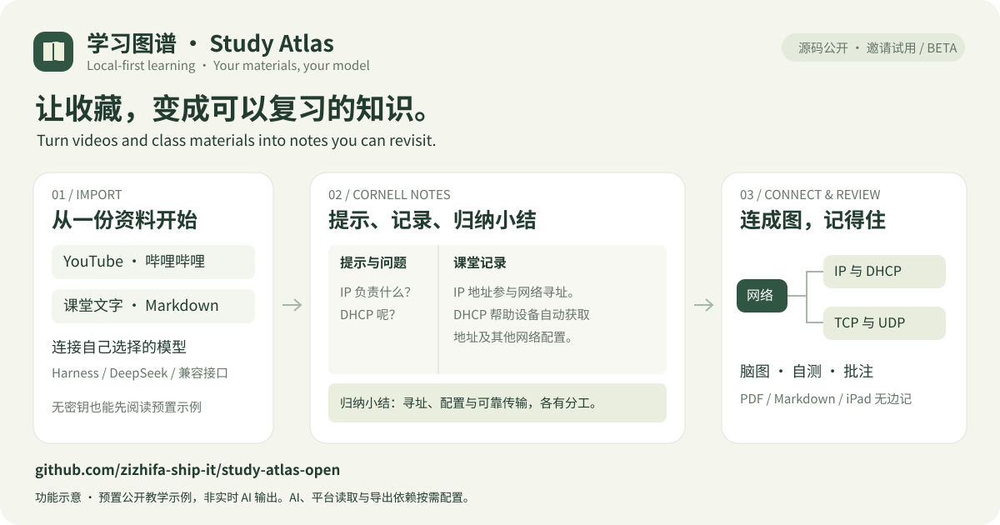

# 邀请你试用 Study Atlas / Try Study Atlas

把收藏的学习资料变成可以阅读、批注和复习的知识库。Study Atlas 在自己的电脑运行，支持 YouTube、哔哩哔哩、课堂文字与 Markdown，提供康奈尔笔记、知识模块、脑图、自测、PDF / iPad 无边记导出，以及 DOI / arXiv 论文知识库和学术路径。

Build a local learning library from videos and class materials, with Cornell notes, mind maps, review questions, PDF / iPad Freeform export, and a DOI / arXiv paper workflow for screening, appraisal, review matrices and citation export. The interface is currently primarily Simplified Chinese.

上图为功能示意；下方示例库是预先编写的公开教学样例，不是真实用户笔记，也不是实时 AI 输出或效果保证。

## 先看笔记，再接模型 / Start with sample notes

1. 从 [测试版与下载](https://github.com/zizhifa-ship-it/study-atlas-open/releases) 选择版本，解压源码包；需先安装 Python 3.9+。
2. Windows 双击 `start.bat`；macOS / Linux 在解压目录运行 `sh start.sh`。浏览器打开 `http://127.0.0.1:8765`，保持启动窗口运行。需要在同一 Wi-Fi 的 iPad 上访问时，运行 `sh start.sh --lan`，再用登录码登录；详见 [局域网与 iPad 访问](局域网与iPad访问.md)。
3. 下载或从源码包中找到 [`examples/demo-library.json`](../examples/demo-library.json)，在网站“导出与备份”中选择“从备份合并导入”。进入“示例｜网络基础”课程，查看康奈尔笔记、脑图和复习问题。该示例无需 AI 密钥、模型下载或视频平台授权。建议使用新的安装目录试用；课程标题明确标注为“示例”。

Download a [test release](https://github.com/zizhifa-ship-it/study-atlas-open/releases), install Python 3.9+, and start with `start.bat` on Windows or `sh start.sh` on macOS/Linux. Open the local site, then import the bundled `examples/demo-library.json` through **导出与备份 → 从备份合并导入**. The prewritten sample needs no AI account. Use a fresh installation to keep it separate from personal learning data.

可以阅读、自测题目、添加批注、导出 JSON / Markdown。AI 生成、翻译和自动批改需另外连接自己的模型；PDF 与无边记导出需安装可选依赖和中文字体。完整步骤见 [安装与模型接入](安装与兼容接口.md)。

## 再试自己的资料 / Try your own material

- 导入一份 TXT / Markdown，或粘贴公开 YouTube / 哔哩哔哩链接。
- 在“AI / Harness 设置”选择自己的 Harness、DeepSeek API、Ollama、LM Studio、硅基流动或 OpenRouter。
- 云端模型可能按自己的账户计费。本机模型需自行安装并启动。公开视频能否取得字幕或音轨取决于平台与网络；AI 笔记仍需结合原资料核对。

Connect your own model for generation, translation and grading. Cloud providers may charge your account; local models require separate installation. Video caption/audio availability varies. Review AI output against its source.

## 给我们反馈 / Share feedback

| 你想说什么 / Type | 入口 / Link |
| --- | --- |
| 初次试用是否顺利 / First-use experience | [试用反馈 / Feedback](https://github.com/zizhifa-ship-it/study-atlas-open/issues/new?template=03-trial-feedback.yml) |
| 安装或功能出错 / Something failed | [报告问题 / Bug](https://github.com/zizhifa-ship-it/study-atlas-open/issues/new?template=01-bug-report.yml) |
| 想增加一个功能 / Suggest an improvement | [功能建议 / Idea](https://github.com/zizhifa-ship-it/study-atlas-open/issues/new?template=02-feature-request.yml) |

GitHub 提交反馈需要登录账号，内容公开可见。告诉我们：试到了哪一步、最有用的部分、最想改的一件事。无需上传笔记正文、字幕、API Key、Cookie、OAuth 或客户资料；报错与截图先脱敏。不会使用 GitHub 的朋友，可把本页链接发给邀请你的朋友，由其在征得你同意后转述问题。

GitHub feedback requires sign-in and is public. Tell us how far you got, what helped and one thing to improve. Do not post private notes, captions or credentials. Redact screenshots and errors first.

## 许可 / Licensing

非商业用途免费。受新许可约束的新增内容，商业使用需先书面申请并按约付费；旧 MIT 内容保留原有权利。完整范围见 [商业许可说明](../COMMERCIAL-LICENSE.md)。This is a source-available project with a commercial-use restriction on newly licensed material; legacy MIT rights are preserved.
